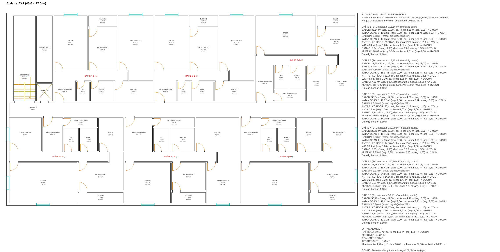

# Plan Robotu — AutoCAD için otomatik kat planı

Plan Robotu, AutoCAD'de çizdiğiniz bir dikdörtgenin içine **Planlı Alanlar İmar Yönetmeliği (PAİY)** asgari ölçülerini sağlayan bir kat planı taslağı çizer. Formda verdiğiniz bilgilere göre şu öğeleri yerleştirir:

- daireler ve mahaller
- merdiven evi, asansör ve kat holü
- kapılar ve pencereler

Ardından her mahal için bir uygunluk raporu üretir.



## Kurulum

1. `PlanRobotu.lsp` ve `PlanRobotu.dcl` dosyalarını aynı klasöre koyun.
2. O klasörü AutoCAD'e tanıtın: **Seçenekler → Dosyalar → Destek Dosyası Arama Yolu** listesine ve **Güvenilen Konumlar** listesine ekleyin.
3. `APPLOAD` komutuyla `PlanRobotu.lsp` dosyasını yükleyin. Her açılışta yüklenmesini istiyorsanız dosyayı *Başlangıç Paketi*'ne ekleyin.

Desteklenen sürüm AutoCAD 2021 ve sonrasıdır. Dosyalar UTF-8 kodludur ve Türkçe karakter içerir.

`PlanRobotu.dcl` bulunamazsa robot formu geçici klasöre kendisi yazar.

`PlanRobotu.dcl` dosyası **Windows-1254 (Türkçe ANSI)** kodludur, çünkü AutoCAD form dosyalarını ANSI kod sayfasıyla okur. Bu dosyayı elle düzenlemeyin; `araclar/dcl_uret.py` ile üretilir.

**Güncellerken:** Yeni dosyaları eskilerin üzerine kaydedin ve AutoCAD'i yeniden başlatın ya da `APPLOAD` ile yeniden yükleyin. Yükleme sırasında komut satırında `Plan Robotu 1.3 yüklendi` yazmalıdır. Başlangıç Paketi'nde ya da destek klasörlerinde eski bir kopya kalmadığından emin olun.

## Kullanım

1. Binanın **dış konturunu** kapalı, 4 köşeli, dik açılı bir `LWPOLYLINE` (Rectangle) olarak çizin. Dikdörtgen döndürülmüş olabilir.
2. `PLANROBOTU` komutunu (kısa yol: `PROBOT`) çalıştırın ve dikdörtgeni seçin.
3. Açılan formu doldurun.

**Genel Ayarlar** bölümü:

| Alan | Açıklama |
|---|---|
| Daire sayısı | 1–30 arası. Değiştirince Enter'a basın; daire listesi güncellenir. |
| Çizim birimi | `cm`, `m` veya `mm`. Dikdörtgen bu birimle okunur. |
| Dış duvar kalınlığı | cm |
| İç duvar kalınlığı | cm. Daire içi bölme duvarlarıdır. |
| Daire / hol ayırıcı duvar | cm. Daireler arası ve daire–kat holü arası duvardır. |
| Kat yüksekliği | cm. Merdiven rıht sayısı buna göre hesaplanır. |
| Asansör kuyusu çiz | Kuyu 1,80 × 2,00 m çizilir (kabin 1,20 × 1,50 m için). |
| Uygunluk raporunu çizime yaz | Rapor, konturun sağına yazılır. |

**Daire Mahalleri** bölümü:

- **Düzenlenen daire** listesinden bir daire seçin.
- Her mahal tipinin adedini girin: salon, yatak odası, mutfak, banyo, WC, kiler, balkon.
- **Hazır şablon** listesinden 1+0, 1+1, 2+1, 3+1 veya 4+1 seçebilirsiniz.
- **Bu daireyi tüm dairelere kopyala** düğmesi, seçili dairenin programını diğer dairelere uygular.

Tamam'a bastığınızda plan çizilir. Rapor komut satırına da yazılır. Tüm çizim tek bir `U` (geri al) ile kaldırılabilir.

Form değerleri AutoCAD oturumu boyunca hatırlanır.

## Plan kurgusu

Robot iki kurgudan, daireleri daha az sıkıştıranı seçer:

- **Kurgu A (1–2 daire):** Merdiven evi ve kat holü ortadadır; tek dairede kenardadır. Daireler iki yandadır.
- **Kurgu B (3+ daire):** Uzun eksen boyunca orta kat holü vardır. Merdiven ve asansör arka sıranın ortasındadır. Daireler ön sıraya ve arka sıranın iki yanına dağıtılır. Dağıtım, en dolu segmentin doluluğunu en aza indirecek şekilde yapılır.

Her daire, girişten cepheye doğru üç bant halinde planlanır:

1. **Servis bandı** (giriş tarafı): antre, ıslak hacimler (WC, banyo, kiler) ve gerekirse mutfak. Islak hacimler koridor tarafında yaklaşık 2,60 m derinlikte kümelenir. Bant daha derinse giriş duvarı boyunca kalan şerit, antreden girilen **vestiyer / depo** olur. Dairenin yan cephesi dışarıdaysa bu bandın uçlarına pencereli yatak odası yerleşebilir.
2. **Daire içi koridor:** 1,10 m genişliktedir ve son kapıdan sonra biter. Artan şerit en fazla 3 m olarak son odaya katılır.
3. **Cephe bandı:** salon, mutfak ve yatak odaları. Gündüz zonu (salon, mutfak) girişe yakın, gece zonu (yatak odaları) uzaktadır. Köşe odalar yan cepheden de pencere alır. Balkonlar odanın önüne gömülü (loggia) çizilir.

Merdiven çekirdeği (Kurgu B'de) daire genişliklerini en dengeli bölecek konuma kaydırılır. Boş, kullanılmayan alan bırakılmaz.

## Örnek planlardan çıkarılan tasarım profili

Robot her daire için olası tüm yerleşimleri dener ve her birini bir **tasarım profili**ne göre puanlar. Denenen seçenekler şunlardır:

- mutfağın yeri (cephe bandı veya iç bant)
- yan cepheye alınan yatak odaları
- balkonun hangi odaya verileceği
- servis bandının derinliği

En iyi puanı alan yerleşim çizilir. Profil, gerçek konut planı örneklerinden (Singapur, Kore ve Avrupa tipi daireler, tip kat planları, modüler daire tipleri) çıkarılan şu kurallara dayanır:

| Kural | Uygulama |
|---|---|
| Odalar kareye yakındır, uzun şerit değildir | Uzun/kısa kenar oranı: yatak 1,25 (en fazla 1,7), salon 1,45 (en fazla 2,0), banyo 1,4, mutfak 1,6 |
| Oda büyüklükleri belirli aralıktadır | Ebeveyn odası 13,5 m², diğer yatak odaları 11 m², salon 18 + 3 × yatak sayısı m², mutfak 9 m², banyo 5 m², WC 2,2 m² |
| Sirkülasyon azdır | Antre + koridor, daire alanının %12'sini aşınca puan düşer |
| Islak hacimler kümelenir, cephe almaz | WC, banyo ve kiler yan yana, koridor tarafında |
| Fazla alan yaşam mahallerine gider | Büyüme ağırlıkları: salon 3, yatak 1,5, mutfak 1, ıslak hacimler 0,1–0,3 |
| Aynı tip daireler eşit büyüklüktedir | Daireler sıralara büyüklükleri birbirine yakın kalacak şekilde dağıtılır |

Bu değerler `PlanRobotu.lsp` içindeki **`*pr-profil*`** tablosundadır. Kendi tasarım alışkanlıklarınıza göre değiştirerek robotu "yeniden eğitebilirsiniz". Örneğin daha büyük yatak odaları için ideal alanı artırabilir, daha az koridor için `*pr-sirkulasyon-hedef*` değerini düşürebilirsiniz.

## Yönetmelik değerleri

Asgari ölçüler `PlanRobotu.lsp` dosyasının başındaki **`*pr-mahal-tipleri*`** tablosunda ve hemen altındaki değişkenlerde tutulur. Varsayılan değerler şunlardır:

| Mahal | Asgari alan | Asgari dar kenar |
|---|---|---|
| Salon / oturma odası | 12,00 m² | 3,00 m |
| Yatak odası | 9,00 m² | 2,50 m |
| Mutfak | 3,30 m² | 1,50 m |
| Banyo | 3,00 m² | 1,50 m |
| WC (hela) | 1,20 m² | 1,00 m |

Ortak alanlar ve diğer ölçüler için varsayılanlar şöyledir:

- Daire içi koridor: 1,10 m
- Kat holü: 1,50 m
- Merdiven: kol 1,20 m, rıht ≤ 18 cm, basamak 27 cm
- Antre genişliği: 1,20 m

PAİY her daire için en az 1 oda, 1 mutfak, 1 banyo ve 1 hela ister. Form bunu kontrol eder. WC girilmezse rapora "hela banyo içinde çözülmelidir" notu düşülür.

> ⚠️ Bu değerler yönetmeliğin bilinen asgari ölçülerine göre girilmiştir. Proje öncesinde **yürürlükteki PAİY metni** ve varsa **belediyenizin imar yönetmeliği** ile karşılaştırın. Gerekirse tablo üzerinden güncelleyin. Robotun ürettiği çizim bir **ön tasarım taslağıdır**. Mimari tasarım, yangın yönetmeliği, otopark, sığınak ve erişilebilirlik gibi koşulların mimar tarafından kontrol edilmesi gerekir.

## Katmanlar

| Katman | İçerik |
|---|---|
| `PR-DUVAR` | Mahal sınırları (duvar yüzleri; kapı ve pencere boşlukları açık) |
| `PR-KAPI` | Kapı kanatları ve açılım yayları |
| `PR-PENCERE` | Pencere sembolleri |
| `PR-MERDIVEN` | Basamaklar, merdiven gözü, çıkış oku, asansör kuyusu |
| `PR-YAZI` | Mahal adı, net alan, ölçüler |
| `PR-DAIRE` | Daire etiketleri |
| `PR-RAPOR` | Uygunluk raporu |

Yazılar `PR_YAZI` stilini (Arial) kullanır.

## Testler

Geometri ve rapor çekirdeği AutoCAD olmadan test edilebilir. `test/lisp_sim.py`, AutoLISP'in bu dosyada kullanılan alt kümesini yorumlar:

```bash
python3 AutoCAD/PlanRobotu/test/test_plan_robotu.py --svg cikti
```

`test/lisp_lint.py` ayrıca parantez dengesini ve AutoLISP'te aynı değişken sayılan, yalnız harf büyüklüğü farklı adları (`W`/`w`) denetler.

Test her senaryo için şunları doğrular:

- mahaller birbiriyle çakışmıyor
- mahaller iç konturdan taşmıyor
- yeterli alanda tüm kontroller UYGUN çıkıyor
- yetersiz alanda uygunsuzluk raporlanıyor

`--svg` verilirse her senaryonun planı SVG olarak kaydedilir.
